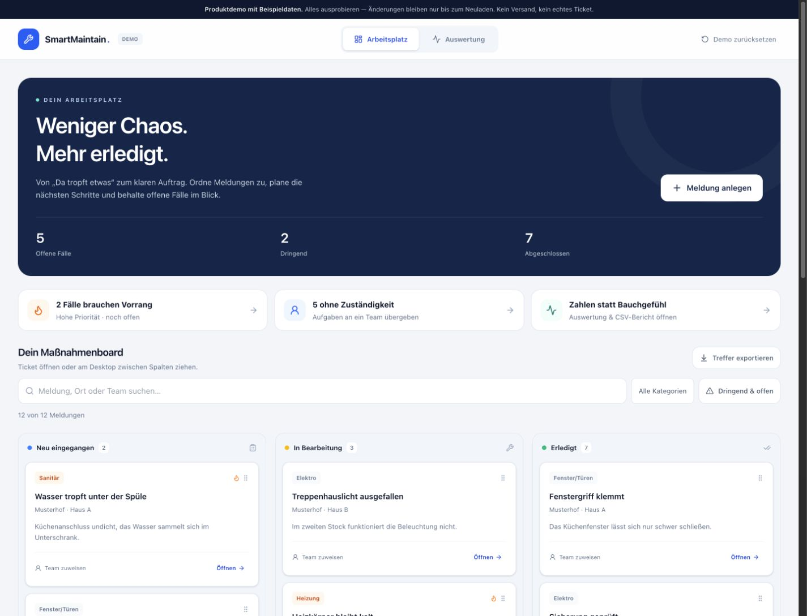
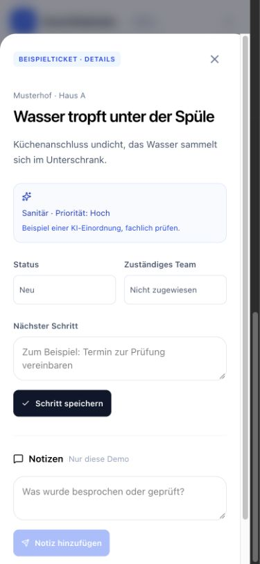
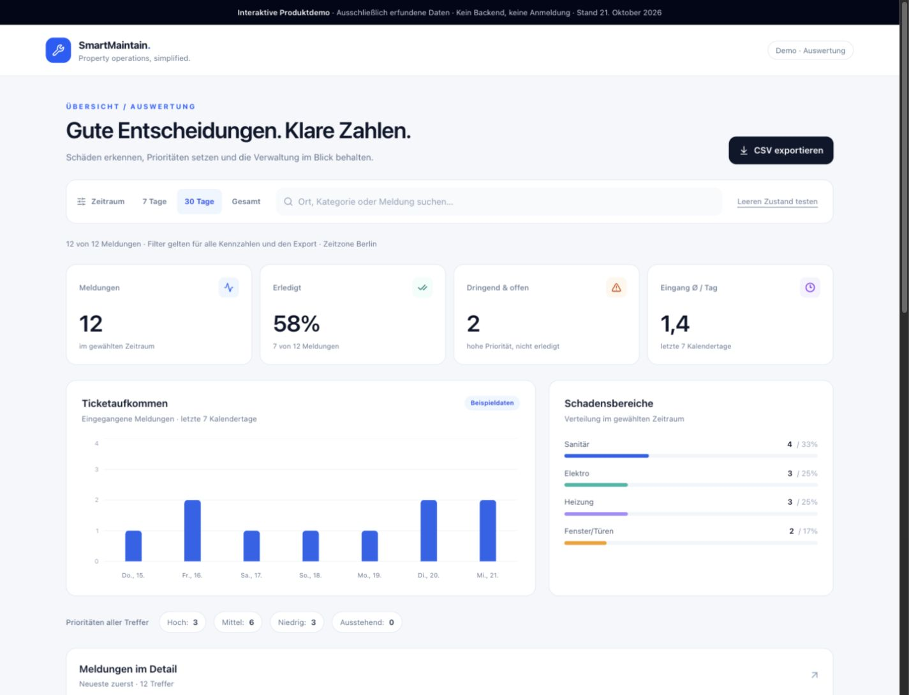
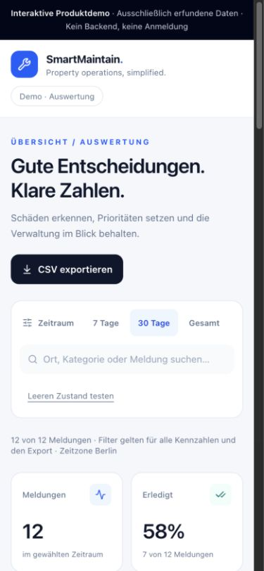

# SmartMaintain

**Von der Schadensmeldung zur klaren Priorität.**

Ein Prototyp für digitale Hausverwaltung: Mieter melden Schäden mit Foto,
Gemini unterstützt die Einordnung und die Verwaltung verfolgt Tickets in Echtzeit.
Der neue Demo-Arbeitsplatz macht den Ablauf interaktiv erlebbar: Meldungen
sichten, Teams zuweisen und nächste Schritte planen. Die gemeinsame
Auswertung zeigt Aufkommen, offene Prioritäten und Erledigungsstand.



**[Demo lokal starten](#in-60-sekunden-ausprobieren)** ·
**[Architektur & Entscheidungen](docs/analytics-contribution.md)** ·
**[Änderungen und Beiträge](https://github.com/alem187/SmartMaintainer/pulls)**

> Entwicklungsprototyp. `/demo` funktioniert vollständig mit erfundenen Daten.
> Die vorhandene rollenbasierte Anmeldung ist eine Browser-Demo; vor echtem
> Mieterbetrieb braucht das Backend eine vollständige Zugriffskontrolle.

## In 60 Sekunden ausprobieren

Node.js **22.18 oder neuer**; für CI wird Node 24 verwendet.

```bash
npm ci
npm run dev
```

**[localhost:3000/demo](http://localhost:3000/demo)** öffnen.
Für die Demo sind keine API-Keys, Convex-Konfiguration oder Anmeldung erforderlich.

1. Im **Arbeitsplatz** eine Karte öffnen und ein zuständiges Team auswählen.
2. Einen **nächsten Schritt** speichern, eine **Notiz** ergänzen und den Status ändern.
3. Am Desktop Karten zwischen den drei Statusspalten ziehen; mobil den Status im Detail ändern.
4. **Meldung anlegen** ausprobieren und nach Ort oder Team suchen. Filter zeigen dringende oder unzugewiesene offene Fälle.
5. Zur **Auswertung** wechseln: Die geänderten Tickets fließen direkt in die Kennzahlen ein.
6. Dort Zeitraum und Suche ausprobieren, CSV exportieren oder den Leerzustand testen.
7. **Demo zurücksetzen** stellt die ursprünglichen Beispieltickets wieder her.

Die zwölf ursprünglichen Meldungen und Orte sind handgeschriebene Fiktion.
Ihr Bezugsdatum ist absichtlich auf den 21. Oktober 2026 fixiert, damit die Demo
reproduzierbar bleibt. Änderungen existieren nur im Arbeitsspeicher dieses
Browser-Tabs und gehen beim Neuladen verloren. Teamzuweisungen verschicken
keine Nachrichten; neue Meldungen erzeugen keine echten Tickets. Es gibt keine
Datenbankverbindung, KI-Anfrage oder Speicherung im Browser.

<details>
<summary>Mobile Arbeitsplatz-Vorschau ansehen</summary>



</details>

<details>
<summary>Auswertung auf Desktop und Smartphone ansehen</summary>





</details>

## Was die Anwendung kann

| Bereich           | Funktionen                                                                            |
| ----------------- | ------------------------------------------------------------------------------------- |
| Schadensmeldung   | Mobiles Formular, Fotovorschau und Upload, Erfolgszustand                             |
| KI-Unterstützung  | Kategorie, Dringlichkeit und Zusammenfassung über Gemini; Fallback bei Fehlern        |
| Ticketverwaltung  | Echtzeitliste, Statusfilter und Statuswechsel im Dashboard                            |
| Auswertung        | Gemeinsame Oberfläche für Admin und Viewer, Zeitraum und Suche, lesbare Details       |
| Kennzahlen        | Erledigungsrate, offene hohe Prioritäten, tatsächliches 7-Tage-Aufkommen              |
| Export            | Gefilterte CSV mit UTF-8-BOM, konsistenter Maskierung und Schutz gegen Formelpräfixe  |
| Demo-Arbeitsplatz | Drei Statusspalten, Teamzuweisung, nächste Schritte, Notizen und neue Beispieltickets |
| Demo-Auswertung   | Gemeinsamer Ticketstand mit dem Arbeitsplatz; Filter, CSV und testbarer Leerzustand   |

Arbeitsplatz-Funktionen wie Teams, nächste Schritte und Notizen sind ausschließlich
in der isolierten Demo implementiert. Sie sind nicht an das bestehende
Convex-Backend angebunden. Der CSV-Report exportiert Ticketdaten; Zuweisungen,
nächste Schritte und Notizen sind darin nicht enthalten.

Die Kennzahlen verwenden **Europe/Berlin** und Kalendertage, auch bei
Sommerzeitwechseln. „Eingang Ø/Tag“ misst Meldungen, keine Bearbeitungsdauer.
KI-Prioritäten sind Vorschläge und müssen fachlich geprüft werden.

## Technischer Aufbau

| Technologie                        | Aufgabe                                                |
| ---------------------------------- | ------------------------------------------------------ |
| Next.js 16 / React 19 / TypeScript | App Router, Oberfläche und Typprüfung                  |
| Convex                             | Datenbank, Storage, Mutations und Echtzeit-Abonnements |
| Google Gemini                      | Unterstützende Schadensanalyse                         |
| Tailwind CSS 4 / Lucide            | Responsive Darstellung und Icons                       |
| Recharts                           | Ticketaufkommen als Balkendiagramm                     |
| Node-Testläufer / GitHub Actions   | Regressionstests und automatisierte Qualitätsprüfung   |

```text
src/app/demo/                Eigenständiger Demo-Einstieg mit Beispieldaten
src/components/DemoWorkspace.tsx
                             Interaktives Board und gemeinsamer Demo-Zustand
src/lib/workspace.ts         Reine Funktionen für lokalen Ticket-Workflow
src/app/admin/               Verwaltung und Analytics
src/app/viewer/              Lesende Übersicht und Analytics
src/components/AnalyticsReport.tsx
                             Gemeinsame Report-Oberfläche
src/lib/analytics.ts          Filter, Kalenderauswertung, CSV (ohne React/Backend)
src/lib/demo-tickets.ts       Synthetische, reproduzierbare Fixtures
src/hooks/useDemoAccess.ts    Bestehende Browser-Rollenprüfung, keine Server-Auth
convex/                      Bestehende Datenbank-, Storage- und KI-Funktionen
tests/analytics.test.mjs      Analytics-Regressionstests
tests/workspace.test.mjs      Lokaler Workflow und unveränderliche Updates
```

Das Trennen von Datenladen, reinen Berechnungen und Darstellung hält die beiden
Rollen konsistent und macht die Geschäftslogik ohne laufendes Backend testbar.
Siehe [Entscheidungen und Validierung](docs/analytics-contribution.md).

## Echtzeitbetrieb lokal einrichten

Für die ursprünglichen Formular- und Verwaltungsfunktionen wird ein eigenes
Convex-Entwicklungsbackend benötigt. Keine produktiven Mieterdaten verwenden.

```bash
# Einmalig ein eigenes lokales Entwicklungsbackend konfigurieren:
npx convex dev --configure new --dev-deployment local
```

Convex schreibt die Projektkonfiguration einschließlich `NEXT_PUBLIC_CONVEX_URL`
in `.env.local`. Diese Datei ist von Git ausgeschlossen. Optional einen eigenen
[Google AI API Key](https://aistudio.google.com/apikey) im **Convex-Backend** setzen:

```bash
npx convex env set GOOGLE_API_KEY '<eigener-api-key>'
```

Den Google-Key nie als `NEXT_PUBLIC_*` veröffentlichen. Ohne Key verwendet die
vorhandene KI-Funktion einen Fallback.

Danach zwei Terminals starten:

```bash
# Terminal 1
npx convex dev

# Terminal 2
npm run dev
```

- `/`: Schadensmeldung
- `/admin/login`: bestehende Demo-Anmeldung
- `/admin` und `/admin/analytics`: Verwaltung
- `/viewer` und `/viewer/analytics`: lesende Oberfläche
- `/demo`: isolierter Arbeitsplatz mit Board und Auswertung

## Qualität prüfen

```bash
npm test                  # Analytics und lokaler Ticket-Workflow
npm run lint
npm run typecheck
npm run build             # ohne Convex- oder Gemini-Secrets möglich
npm audit --omit=dev
```

Die 14 Regressionstests umfassen zehn Analytics- und vier Workflow-Tests.
GitHub Actions prüft Pull Requests mit Node 24. Ein Produktionsbuild benötigt
Netzwerkzugriff für die bestehende Google-Font-Integration.

Am 21.10.2026: Produktionsaudit ohne bekannte Lücken. Im vollständigen Audit
bleiben fünf hohe Meldungen in der ESLint-Glob-Abhängigkeitskette; Details und
weitere Grenzen stehen in der [technischen Dokumentation](docs/analytics-contribution.md).

## Mitwirken und nächste Schritte

Kleine, nachvollziehbare Pull Requests mit Beschreibung des Problems und
passender Validierung sind willkommen. Bei Analytics-Änderungen die reinen
Funktionen erweitern und relevante Grenzfälle testen. Screenshots nur mit
synthetischen Daten erstellen.

Sinnvolle nächste Schritte: serverseitige Authentifizierung und Rollenprüfung,
Uploadvalidierung und Missbrauchsschutz sowie serverseitige Aggregation und
Pagination bei größeren Beständen. Ein Erledigungszeitpunkt würde später
belastbare Bearbeitungszeit-Kennzahlen ermöglichen.

Der Beitrag ergänzt die bestehende Anwendung um den Demo-Arbeitsplatz, die
gemeinsame Auswertung und ihre Tests; die Projektgeschichte
und ursprüngliche Urheberschaft bleiben erhalten. Eine konkrete Formulierung
für den eigenen Beitrag steht am Ende der technischen Dokumentation.

## Lizenzhinweis

Das ursprüngliche README nennt MIT. Eine zugehörige LICENSE-Datei ist im
aktuellen Repository noch durch die Maintainer zu ergänzen.
